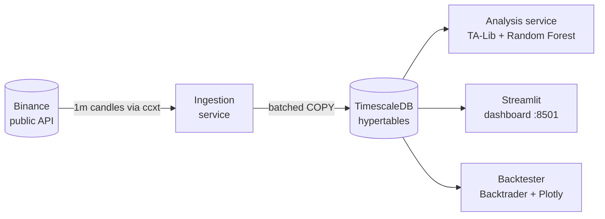

# Crypto Bot Homelab

[](https://github.com/benw312/crypto-bot-homelab/actions/workflows/tests.yml)
[](LICENSE)

A containerised crypto market-data platform that runs on a home server. It
ingests live BTC and ETH prices every minute into a time-series database,
computes technical indicators, trains a machine-learning signal model per
asset, backtests trading strategies and serves an interactive dashboard with
a paper-trading simulator.


**Stack:** Python 3.12 · asyncio · TimescaleDB (PostgreSQL) · Docker Compose ·
ccxt · TA-Lib · scikit-learn · Backtrader · Streamlit · Plotly · pandas

---

## Highlights

- **Microservice architecture.** Ingestion, analysis and the dashboard run as
  independent containers sharing one TimescaleDB instance, so each can be
  restarted, scaled or replaced without touching the others.
- **Time-series storage.** Market and sentiment data live in TimescaleDB
  hypertables, which partition by time automatically and keep minute-level
  queries fast as history grows.
- **Async ingestion with batched writes.** An `asyncio` loop pulls 1-minute
  candles from the exchange via `ccxt` and bulk-loads them with Postgres
  `COPY`, which keeps disk I/O low on modest homelab hardware.
- **ML signal generation.** The analysis service computes RSI, MACD and
  Bollinger Bands with TA-Lib, then trains a Random Forest per asset to predict
  whether the price will rise more than 1% in the next hour.
- **Evaluated on unseen data.** An evaluation script trains on three weeks of
  history and tests on the following nine days. It reports precision and
  recall against the base rate, plus a fee-inclusive back-test of the model's
  signals against simple baselines. See [Model evaluation](#model-evaluation).
- **Backtesting.** A Backtrader strategy combines RSI with a sentiment
  threshold and plots trades on an interactive Plotly chart.
- **Dashboard and paper trading.** A Streamlit UI shows price against moving
  averages and lets you simulate buys and sells against a virtual wallet.
- **Tested.** Unit tests cover ingestion, indicators, model training and
  prediction, the evaluation's train/test split, metrics and back-test, the
  backtest flow and the dashboard's data layer, with network and database
  calls mocked.

## Screenshots

| Market overview | Paper trading |
|---|---|
|  |  |

## Architecture



| Container | Entry point | Role |
|---|---|---|
| `timescaledb` | — | Stores `market_data` and `sentiment_data` hypertables. The schema is created on first start from `migrations/`. |
| `crypto_ingestion` | `app/ingestion.py` | Fetches the latest 1-minute candle for each symbol every 60 seconds and batch-inserts it. |
| `crypto_analysis` | `app/analysis.py` | Every 15 minutes, computes indicators over the last 500 minutes and trains or loads a model per symbol to score the latest candle. |
| `crypto_dashboard` | `app/dashboard.py` | Streamlit UI on port 8501. |

`app/backtest.py`, `app/backfill.py` and `app/evaluate.py` are run on demand (see below).

## Model evaluation

`app/evaluate.py` measures how well the model would have done on data it never
saw. It uses the same features, target and settings as the live service.

**Method.** I loaded 30 days of 1-minute Binance candles (2026-09-21 to
2026-10-21). The model trained on the first 70% and was tested on the last 30%,
about nine days. A one-hour gap separates the two, because each training label
looks an hour ahead and would otherwise use test-period prices. The indicators
only look backwards, so they can't leak future information either.

| Test set (unseen) | BTC/USDT | ETH/USDT |
|---|---|---|
| Base rate: minutes followed by a >1% rise | 1.4% | 2.9% |
| Rise predictions made | 57 | 4,809 |
| Precision | 49.1% | 5.3% |
| Recall | 15.6% | 68.3% |
| ROC AUC (0.5 = chance) | 0.655 | 0.671 |

| Back-test on the same nine days (buy on signal, sell after 1 hour, 0.1% fee per side) | BTC/USDT | ETH/USDT |
|---|---|---|
| Model signals | +1.28% (3 trades) | −11.17% (87 trades) |
| Baseline: trade every hour | −34.87% (215 trades) | −37.27% (215 trades) |
| Buy and hold | −0.27% | −4.15% |

**What this shows:**

- **The model ranks minutes better than chance, but only modestly.** An ROC
  AUC of about 0.66 for both coins means it orders likely rises above unlikely
  ones more often than not.
- **The BTC precision is too thin to rely on.** Its 57 predictions cluster into
  only 3 separate trades. That isn't enough evidence for the 49% figure to
  mean much.
- **On ETH the model over-predicts.** It flags a rise in 37% of minutes, and is
  right 5.3% of the time against a 2.9% base rate. The likely cause is the
  Bollinger Band features: they are raw price levels, so a tree model handles
  prices outside its training range badly. Turning them into scale-free ratios
  (for example %B) is the obvious next experiment.
- **Neither model beats buy-and-hold after fees.** The model's signals do lose
  far less than trading blindly every hour, which shows the filtering adds
  something. But at 0.2% per round trip, the fees outweigh the edge.

All figures come from one nine-day test window and will change when re-run on
newer data. A walk-forward evaluation across several windows would give a more
reliable estimate.

To reproduce:

```bash
docker compose run --rm ingestion python backfill.py --hours 720
docker compose run --rm analysis python evaluate.py
```

## Getting started

**Prerequisites:** Docker with Docker Compose. No exchange API keys are needed,
because only public market data is used.

```bash
git clone https://github.com/benw312/crypto-bot-homelab.git
cd crypto-bot-homelab
cp .env.example .env            # set DB_PASSWORD (and DB_PORT if 5432 is taken)
docker compose up --build -d
```

Then open <http://localhost:8501>.

The ingestion loop adds one row per minute, so the charts start almost empty.
To load the last 48 hours of history straight away:

```bash
docker compose run --rm ingestion python backfill.py --hours 48
```

To run a backtest, which writes `backtest_results.html`:

```bash
docker compose run --rm analysis python backtest.py
```

## Running the tests

TA-Lib is bundled in the Docker image, so the easiest way to run the tests is
inside the container:

```bash
docker compose run --rm -v "$PWD":/repo -w /repo analysis python -m unittest discover tests
```

To run them locally instead:

```bash
python3 -m venv .venv && source .venv/bin/activate
pip install -r app/requirements.txt
python -m unittest discover tests
```

## Project structure

```
├── app/                    # Current microservices (one shared Docker image)
│   ├── ingestion.py        # Exchange → TimescaleDB loop
│   ├── analysis.py         # Indicators, model training, signals
│   ├── dashboard.py        # Streamlit UI and paper trading
│   ├── backtest.py         # Backtrader strategy and Plotly report
│   ├── backfill.py         # One-off historical data loader
│   ├── evaluate.py         # Held-out model evaluation and signal back-test
│   ├── Dockerfile
│   └── requirements.txt
├── migrations/             # TimescaleDB schema (hypertables)
├── tests/                  # Unit tests
├── legacy/                 # The original Raspberry Pi version (see below)
├── docker-compose.yml
└── .env.example
```

## How it evolved

The project started as a single scheduled Python script on a **Raspberry Pi**
(`legacy/`). That version:

- polled CoinGecko for prices and stored them in SQLite,
- hand-implemented over a dozen indicators (SMA, EMA, MACD, RSI, Bollinger
  Bands, stochastic oscillator, ATR, OBV, parabolic SAR, Ichimoku and more),
- scored Reddit and Twitter sentiment with TextBlob and VADER,
- published everything to InfluxDB for Grafana dashboards,
- sent email alerts on large price moves and backed up nightly to Amazon S3.

As it grew, the monolith became hard to change, so it was re-platformed into
the services above: TimescaleDB replaced SQLite and InfluxDB, a proper indicator
library replaced the hand-written maths, and Docker Compose made it portable
beyond the Pi. The legacy code is kept for reference and reads its credentials
from environment variables (see `.env.example`).

## Limitations and roadmap

- **Sentiment is not yet wired into the new pipeline.** The scoring function
  and the database table are ready, but there is no live social feed. The
  backtest's sentiment filter therefore never triggers on real data, and the
  strategy makes no trades until a feed is added. Twitter's free streaming API
  has since been withdrawn, so Reddit is the likely source.
- **Signals are logged, not stored.** The next step is to write predictions to
  a `signals` table and plot them on the dashboard.
- **The "Live Mode" toggle is a UI placeholder.** No orders are ever sent to an
  exchange.
- **The model target is deliberately simple** (a >1% rise within an hour). In a
  quiet market a 500-minute window may contain no rises at all, in which case
  the service skips the signal rather than guessing.
- **The live service trains on a much shorter window than the evaluation.** It
  trains once, on the most recent 500 minutes, and then reuses that model. The
  evaluation trains on three weeks of history, so it measures the modelling
  approach rather than the exact model the service is running. Scheduled
  retraining on a longer window is the next step.

## License

[MIT](LICENSE) © 2026 Ben Wallbridge
